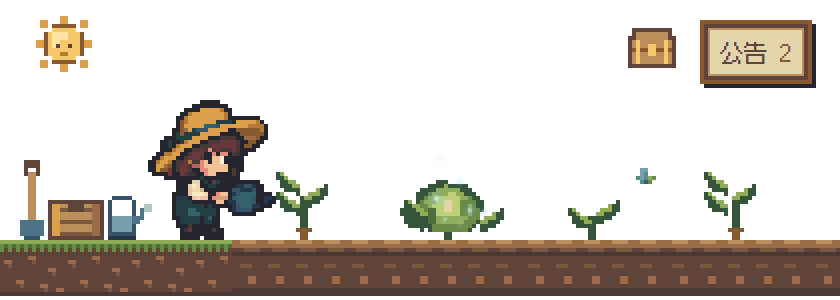
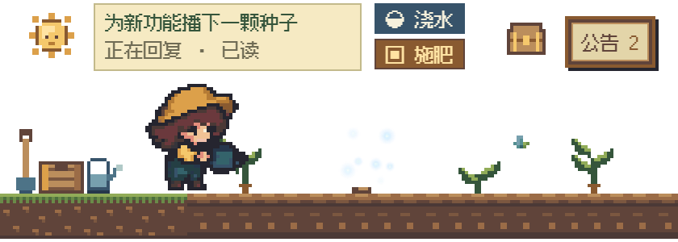
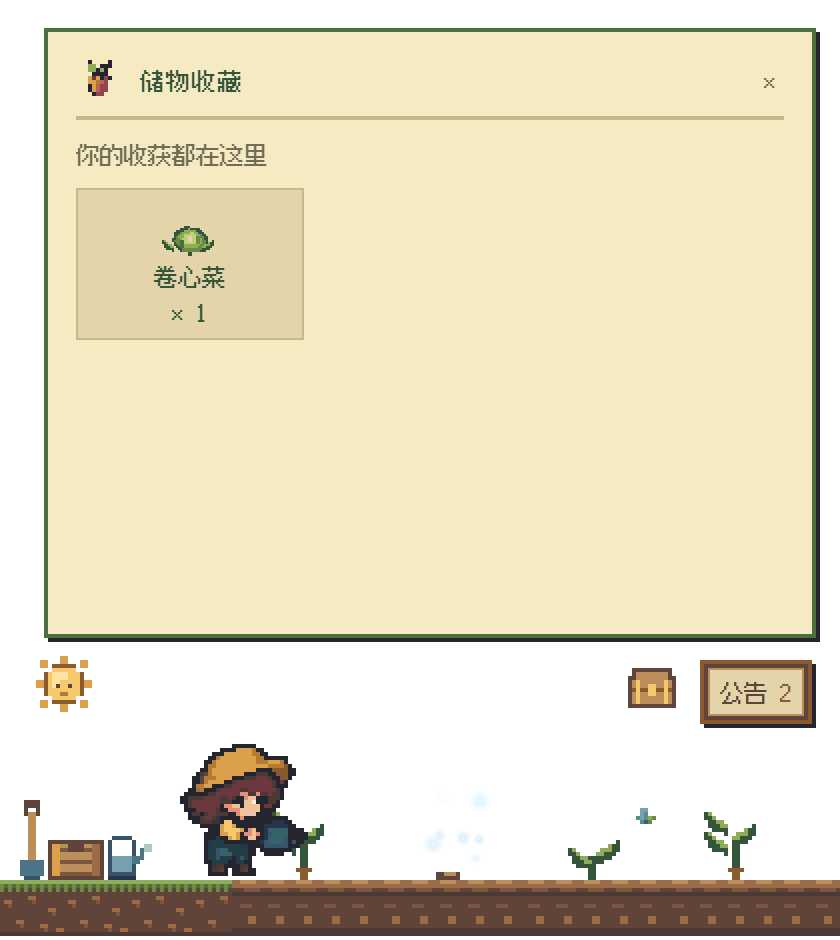
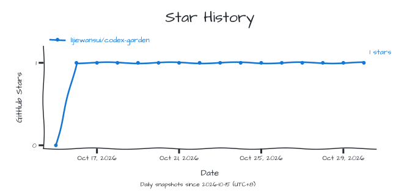

# codex-garden

让每一段 Codex 对话，在桌面上长成一株植物。随着对话推进，看它生长、成熟，将收获留在收藏箱里。

透明的像素菜园静静待在桌面，不抢键盘输入。单击让园丁走近，双击回到对话；工作间隙，也可以浇水、施肥，照料自己的小菜地。

[下载 Windows 候选版](https://github.com/l1jiewansui/codex-garden/releases/tag/v0.10.0-rc.1) · [安装部署手册](docs/INSTALL.md) · [使用指南](docs/USAGE.md) · [问题反馈](https://github.com/l1jiewansui/codex-garden/issues)

> 截图使用演示数据。当前支持 **Windows x64 + Codex 桌面版**；下载包自带运行环境，无需安装 Python 或 Node.js。当前为 **0.10.0-rc.1 候选版**，尚未代码签名或通过公共插件目录审核。

## 三步开始种菜

1. **下载并解压**：在 [Release 页面](https://github.com/l1jiewansui/codex-garden/releases/tag/v0.10.0-rc.1) 下载 `codex-garden-0.10.0-rc.1-windows.zip`，右键选择“全部解压”，不要直接在压缩包里运行。
2. **打开菜园**：进入解压后的文件夹，双击 `CodexGarden.exe`。想加入开始菜单，也可以双击 `Install.cmd`，无需管理员权限。
3. **点击“开始种菜”**：阅读首次说明后确认。打开本机 Codex，稍等几秒，最近的对话就会出现在菜地上。

当前版本沿用旧称“青云菜园”，开始菜单名称为 **Qingyun Garden**。安装、升级、卸载和可选插件接入步骤见[安装部署手册](docs/INSTALL.md)。

## 怎么照料这片菜园

| 想做什么 | 操作 |
|---|---|
| 移动整个菜园 | 按住像素太阳拖动 |
| 让园丁走过去 | 单击土地或植物 |
| 收获并回到对话 | 双击成熟植物；未成熟植物直接打开对话 |
| 看这株植物对应什么 | 鼠标悬停，信息卡显示对话名称与状态 |
| 浇水、施肥 | 悬停后点击两个独立按钮，观看人物动作 |
| 换一种植物或园丁 | 右键植物，打开选择面板 |
| 查看左右菜地 | 使用鼠标滚轮，或公告旁的左右按钮 |
| 查看对话、查看收藏 | 点击公告栏、旁边的收藏箱 |
| 隐藏、找回或退出 | 右键系统托盘里的菜园图标 |

### 看懂植物的状态

- **正在生长**：对话正在进行。
- **已经成熟**：观察到一轮对话完成，可以双击收获。成熟不代表任务已经验收通过。
- **带有微光**：检测到未读回复；无法确定阅读状态时，信息卡会如实显示待确认。
- **已收获**：这一轮已经收过，不会重复增加收藏。

收菜不会修改 Codex 的阅读状态。浇水与施肥只有动画效果，不会改变工作进度。

### 把收获留在收藏箱里

可选植物包括胡萝卜、卷心菜、番茄、南瓜、玉米、草莓，以及月光花、水晶菇等特殊品种。部分成熟植物还会出现隐藏款。

点击公告栏旁的箱子，即可查看已收获的品种和数量。收藏会保留在本机，关闭菜园后再打开仍然存在。

更多操作与常见问题见[使用指南](docs/USAGE.md)。

## 数据与备份

首次确认后，菜园才会读取本机 Codex 数据，显示最近 **24 个未归档对话**。对话和收藏在本机处理，不上传，没有广告、遥测或云同步。

右键托盘图标，可以选择“导出收藏备份”。升级前建议备份；卸载默认保留收藏与设置。备份含对话标识，请勿公开分享。详见[隐私说明](PRIVACY.md)。

## Star 曲线

如果这片小菜园让工作轻松了一点，欢迎在仓库右上角点一个 **Star**。

<a href="https://github.com/l1jiewansui/codex-garden/stargazers">
  <picture>
    <source media="(prefers-color-scheme: dark)" srcset="docs/metrics/star-history-dark.svg">
    <source media="(prefers-color-scheme: light)" srcset="docs/metrics/star-history.svg">
    
  </picture>
</a>

Star 数量每日更新，历史从 2026 年 10 月 15 日开始记录。

---

[安装部署](docs/INSTALL.md) · [使用指南](docs/USAGE.md) · [隐私说明](PRIVACY.md) · [反馈问题](https://github.com/l1jiewansui/codex-garden/issues) · [开发者文档](docs/DEVELOPMENT.md)
