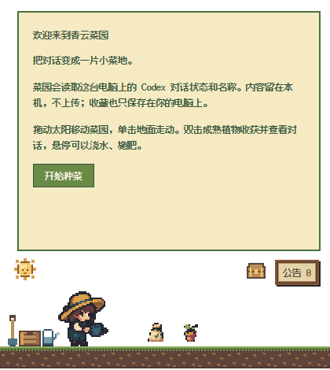

# 安装与部署 codex-garden

[返回首页](../README.md) · [使用指南](USAGE.md)

## 安装前确认

- 使用 Windows x64 电脑，并已安装 Codex 桌面版。
- 先在 Codex 中打开或创建一个对话。
- 下载包已包含运行环境，无需安装 Python、Node.js 或游戏引擎。

当前候选版未代码签名。请从本仓库 Release 获取文件，并保留系统安全保护；如被系统阻止，可先核对文件来源与 SHA256，不建议关闭防护。

## 选择下载内容

打开 [0.10.0-rc.2 下载页面](https://github.com/l1jiewansui/codex-garden/releases/tag/v0.10.0-rc.2)，展开 **Assets**：

| 文件 | 适合谁 |
|---|---|
| `codex-garden-0.10.0-rc.2-windows.zip` | 大多数用户：直接使用桌面菜园 |
| `codex-garden-0.10.0-rc.2-plugin.zip` | 希望从 Codex 对话里调用菜园工具的用户，包含同一桌面程序 |
| 同名 `.zip.sha256` | 对照下载文件的完整性 |
| GitHub 自动生成的 Source code | 源代码，不是可以双击使用的安装包 |

如果下载页面暂时无法打开，可从[仓库的 Releases 列表](https://github.com/l1jiewansui/codex-garden/releases)进入对应版本。

## 方式一：解压即用

1. 下载 **windows.zip**，右键选择“全部解压”。
2. 将整个解压文件夹放在固定位置，例如“文档”中的 `codex-garden` 文件夹。不要只移动 EXE。
3. 进入文件夹，双击 **CodexGarden.exe**。
4. 阅读首次说明，点击 **开始种菜**。稍等几秒即可看到本机最近的对话。



便携方式不创建开始菜单项。下次使用时，再次打开同一个 EXE 即可。

## 方式二：安装到开始菜单

1. 同样先完整解压 **windows.zip**。
2. 双击 **Install.cmd**，等待安装完成。
3. 在 Windows 开始菜单中搜索 **Qingyun Garden**，打开菜园。

安装仅作用于当前用户，无需管理员权限。当前候选版的开始菜单名称为 Qingyun Garden；菜园内显示的名称可以自行修改。

## 可选：接入 Codex 本地插件

直接运行桌面菜园已经可以显示对话。只有希望在聊天中请求“打开菜园”“查看菜园概况”“查看植物收藏”时，才需要安装插件。

本项目尚未上架公共插件目录，当前通过本地插件市场接入。此步骤需要电脑上可运行 Codex CLI。

1. 新建一个本地市场文件夹，例如 `C:\Tools\codex-garden-marketplace`。
2. 将 **plugin.zip** 完整解压到该文件夹内的 `plugins\codex-garden`。确认里面直接包含 `plugin.json`、`mcp.json`、`app`、`server` 和 `skills`，避免多套一层目录。
3. 在市场根目录下创建 `.agents\plugins` 文件夹，将本仓库的 [plugin-marketplace.json](plugin-marketplace.json) 下载到这里，并命名为 **marketplace.json**。
4. 在 PowerShell 中执行：

```powershell
codex plugin marketplace add C:\Tools\codex-garden-marketplace
codex plugin add qingyun-garden@risu1-local-plugins
```

如果使用其他文件夹，只需替换第一条命令的路径。当前插件的内部标识仍为 `qingyun-garden`，请原样使用命令。市场文件中配置的是本地相对路径，不需要填写账号密码或 Token。

重新加载宿主插件后，在新对话中试试：

> 打开青云菜园
>
> 查看菜园概况
>
> 看看我收藏了哪些植物

插件不会替你点击首次使用确认，也不会代为收获。状态工具只返回汇总数量，不返回对话标题、正文或标识。当前聊天可能不会立即刷新新增工具。

## 更新与保留收藏

1. 右键托盘图标，先选择 **导出收藏备份**。
2. 从托盘选择 **退出**，确认旧菜园已退出。
3. 下载新版并完整解压。便携用户运行新版 EXE；安装用户运行新版 Install.cmd。
4. 打开新版，确认收藏仍然存在，再考虑清理解压出的旧应用文件夹。

请勿删除用户目录中的 `.codex-garden`，那是收藏存放位置。当前没有自动联网更新；不要把较新格式的收藏交给不兼容的旧版覆盖。

## 卸载

- **安装版**：从 Windows 的“已安装的应用”中找到 Qingyun Garden 并卸载。先从托盘退出菜园。
- **便携版**：退出后，删除解压出的应用文件夹。
- **本地插件**：在 Codex 插件管理中卸载，或使用 `codex plugin remove qingyun-garden@risu1-local-plugins`。

卸载默认保留收藏与设置。彻底删除个人数据的方法见[隐私说明](../PRIVACY.md)。

<details>
<summary>可选：核对下载文件的 SHA256</summary>

同时下载 ZIP 与同名 `.sha256` 文件。在 ZIP 所在文件夹打开 PowerShell：

```powershell
Get-FileHash .\codex-garden-0.10.0-rc.2-windows.zip -Algorithm SHA256
```

将输出的哈希与 `.sha256` 文件中的哈希对照，应完全一致；大小写不影响比较。SHA256 用于核对文件完整性，不等同于发布者数字签名。

</details>
